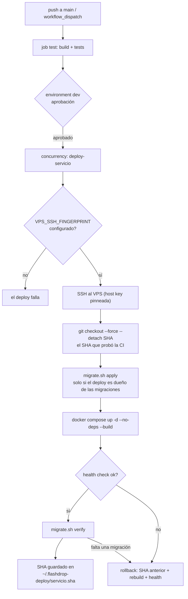

# Runbook de CD — despliegue en el VPS

**Qué es esto:** el manual del pipeline de despliegue continuo de FlashDrop.
Los workflows de CD viven en `.github/workflows/` y todos pasan por un único
workflow reutilizable, `.github/workflows/deploy.yml`, que se apoya en los
scripts de `gateway/docker/scripts/`.

**A quién le sirve:** a quien tenga que aprobar un deploy, a quien tenga que
deshacer uno y a quien toque tocar los scripts de deploy.

**Estado:** describe el pipeline tal como está implementado en la rama
`feat/cd-pipeline-hardening`. Los identificadores técnicos (nombres de secrets,
rutas, comandos, flags) van en inglés/así están en el código.

---

## 1. Cómo funciona el deploy, de punta a punta

1. **Se dispara el workflow CD del servicio.** Un `push` a `main` que toca las
   rutas del servicio (o un `workflow_dispatch` manual) lanza, por ejemplo,
   `.github/workflows/orders-service-cd.yml`.
2. **Corre la CI.** El job `test` del mismo workflow buildea y corre los tests
   (`./gradlew :<servicio>:build`, `./mvnw verify`, `pnpm test` + `pnpm build`).
   Si la CI falla, no hay deploy.
3. **Se espera la aprobación.** El job `deploy` declara `environment: dev` (el
   environment es un input del workflow reutilizable, con `dev` por defecto),
   así que GitHub lo deja en espera hasta que alguien apruebe en ese environment.
4. **Se serializa por servicio.** El job declara
   `concurrency: group: deploy-<servicio>` con `cancel-in-progress: false`: dos
   deploys del mismo servicio nunca se pisan (el segundo espera), y los de
   servicios distintos sí pueden ir en paralelo.
5. **Se verifica el fingerprint SSH.** El primer step del job falla si
   `VPS_SSH_FINGERPRINT` está vacío.
6. **Se entra al VPS por SSH** con `appleboy/ssh-action`, con la host key
   pinneada por fingerprint y `port: 22`.
7. **Se despliega el SHA exacto que probó la CI.** En el servidor el workflow
   resuelve el repo (`~/flashdrop_backend`), hace
   `git fetch --no-tags origin <SHA>` y `git checkout --force --detach <SHA>`,
   donde `<SHA>` es `github.sha`, el commit que disparó el workflow. **No se
   despliega `origin/main`**: lo que se despliega es lo que pasó los tests.
   El `--force` reemplaza los archivos versionados y deja intactos los
   archivos ignorados por git (por ejemplo `gateway/docker/.env` del servidor).
8. **Hace el trabajo `gateway/docker/scripts/deploy-service.sh`**, que es el
   dueño del deploy en el servidor: aplica las migraciones que el deploy
   tiene a su cargo, rebuildea el contenedor, espera el health check, verifica
   el esquema y, si algo falla, vuelve a la versión anterior.
9. **Se registra la versión buena.** El SHA desplegado se escribe en
   `~/.flashdrop-deploy/<servicio>.sha`, que es el punto de partida del
   rollback.



### Configuración por servicio

Los valores vienen de los callers (`.github/workflows/<servicio>-cd.yml`) y de
`gateway/docker/scripts/deploy-services.conf`:

| Servicio | Compose service | Health URL | Migraciones | Dueño | Esquema |
| --- | --- | --- | --- | --- | --- |
| auth | `auth-service` | `http://127.0.0.1:8081/actuator/health` | `services/auth-service/src/main/resources/db/migration` | la app | `public` |
| catalog | `catalog-service` | `http://127.0.0.1:8082/actuator/health` | `services/catalog-service/src/main/resources/db/migration` | la app | `public` |
| delivery | `delivery-service` | `http://127.0.0.1:8084/actuator/health` | `services/delivery-service/src/main/resources/db/migration` | la app | `internal` |
| orders | `orders-service` | `http://127.0.0.1:8083/actuator/health` | `services/orders-service/src/main/resources/db/migration` | el deploy | `public` |
| gateway | `gateway` | `http://127.0.0.1:3000/health` | — | — | — |

El gateway no tiene base de datos: no tiene migraciones que aplicar ni que
verificar. Catalog además tiene un *pre-deploy*:
`bash infra/demo-images/upload.sh`, que sube los assets de demo antes de
levantar el contenedor, porque su migración `V4__set_demo_product_images.sql`
apunta a objetos que tienen que existir ya.

### Qué dispara cada workflow

| Workflow | Se dispara con |
| --- | --- |
| `auth-service-cd.yml` | `push` a `main` con cambios en `services/auth-service/**`, `services/shared-observability/**`, `services/*.gradle.kts` o el propio workflow |
| `catalog-service-cd.yml` | `push` a `main` con cambios en `services/catalog-service/**` o el propio workflow |
| `delivery-service-cd.yml` | `push` a `main` con cambios en `services/delivery-service/**`, `services/shared-observability/**`, `services/*.gradle.kts` o el propio workflow |
| `orders-service-cd.yml` | `push` a `main` con cambios en `services/orders-service/**` o el propio workflow |
| `gateway-cd.yml` | `push` a `main` con cambios en `gateway/**` o el propio workflow |
| `web-cd.yml` | `push` a `main` con cambios en `apps/web/**` o el propio workflow |

`web-cd.yml` no usa `deploy-service.sh`: arma el bundle de `apps/web`, lo copia
por SCP al VPS y lo sincroniza al bucket `flashdrop-web` de FloCI S3. Igual que
los demás, pide aprobación en `dev`, se serializa con
`concurrency: deploy-web` y exige el fingerprint.

---

## 2. Secrets que necesita el deploy

Se configuran en **Settings → Secrets and variables → Actions → Repository
secrets**.

| Secret | Estado | Para qué sirve |
| --- | --- | --- |
| `VPS_HOST` | ya existe | Host del VPS |
| `VPS_USER` | ya existe | Usuario SSH con permisos de deploy |
| `VPS_SSH_KEY` | ya existe | Llave privada SSH |
| `VPS_SSH_FINGERPRINT` | **nuevo, obligatorio** | Fingerprint de la host key del VPS |

### Cómo calcular `VPS_SSH_FINGERPRINT`

El fingerprint se calcula **fuera de banda**, desde una máquina en la que la
conexión ya sea de confianza (tu laptop, un servidor de jump, la consola del
proveedor):

```bash
ssh-keyscan -p 22 <host-del-vps> | ssh-keygen -lf -
```

Salida típica:

```text
256 SHA256:AbCdEf...== root@<host-del-vps> (ED25519)
```

El valor a pegar en el secret es el de esa línea (el `SHA256:...`). **No** lo
calcules con `ssh-keyscan` contra el mismo servidor al que después vas a
desplegar sin verificar antes el resultado por otro canal: `ssh-keyscan` no
autentica al servidor, solo lee la clave que ofrece.

### Por qué es obligatorio

`appleboy/ssh-action` acepta cualquier host key si no se le pasa el
fingerprint. Sin ese pin, un intermediario que se haga pasar por el VPS
recibiría la llave de deploy y el secret `VPS_SSH_FINGERPRINT` no existiría
como barrera. Con el fingerprint, la conexión falla si la host key del servidor
no es exactamente la esperada.

Por eso los dos workflows de deploy (`deploy.yml` y `web-cd.yml`) tienen un
guard que corta el deploy antes de conectar si el secret está vacío:

```text
::error::VPS_SSH_FINGERPRINT is empty.
The SSH host key must be pinned before deploying
(see the CD runbook). Without a fingerprint the SSH
step accepts any host key.
```

Si el VPS se reinstala y cambia la host key, hay que actualizar el secret con
el fingerprint nuevo; si no, el deploy falla en el paso de SSH.

---

## 3. El environment `dev` de GitHub

El job `deploy` del workflow reutilizable declara `environment: dev`, y
`web-cd.yml` declara el mismo environment. Eso es lo que pone el deploy en
espera de una aprobación humana.

> **El environment de GitHub no es un ambiente de ejecución.** No crea
> servidores ni bases: es una etiqueta con un juego de reglas aplicado a un
> destino de deploy. El nombre `dev` corresponde a la etapa actual del
> proyecto (el VPS de desarrollo); cuando exista el ambiente de producción
> real —con su dominio y su HTTPS— se crea un environment `production` aparte
> y se le pasa `environment: production` al workflow, sin tocar los callers.

### Cómo configurarlo

1. **Settings → Environments → New environment**, nombre `dev`.
2. En `dev`, activá **Required reviewers** y agregá a las personas o
   equipos que pueden aprobar. Sin *wait timer*: el deploy espera lo que
   haga falta hasta que alguien lo apruebe.
3. Opcional: **Deployment branches and tags** → dejalo en *All branches* si
   querés que `main` y los deploys manuales puedan usar el environment. Con
   *Protected branches only*, un `workflow_dispatch` desde una rama que no
   sea `main` queda bloqueado.

La aprobación se hace desde la pestaña **Environments** del run en GitHub
Actions, o por el aviso que GitHub manda a los reviewers.

### El aviso importante

**Mientras el environment `dev` no exista con sus required reviewers
configurados, la puerta de aprobación no existe.** GitHub crea el environment
de forma implícita la primera vez que un job lo referencia, pero lo crea sin
reglas de protección: el job no espera a nadie y despliega directo al VPS. Es
decir, el environment hay que crearlo y configurarlo **antes** del primer
deploy.

El environment creado de forma implícita es **el mismo** que después se
configura a mano: cuando se le agreguen los required reviewers, rigen desde ese
momento y el historial de deployments ya registrado se conserva. Ojo, eso sí:
según la documentación de GitHub, **solo un admin del repositorio puede
configurar las reglas de protección** de un environment. Si tu cuenta no es
admin, el `dev` queda sin puerta de aprobación hasta que alguien con permisos
la active.

Sobre la disponibilidad de *Required reviewers*: en repositorios públicos está
disponible en todos los planes; en repositorios privados o internos puede
depender del plan (típicamente GitHub Pro, Team o Enterprise Cloud). Si el
toggle no aparece en tu repositorio, no es un error de configuración del
pipeline: es una restricción del plan. En ese caso hay que asegurar la
aprobación por otro lado (por ejemplo, revisando el run antes de que llegue al
VPS) y dejar la migración al environment apenas el plan lo permita.

---

## 4. Política de migraciones

### Quién aplica qué

| Servicio | Migraciones | Qué hace el deploy |
| --- | --- | --- |
| auth, catalog, delivery | Las aplica la propia app al arrancar (Flyway habilitado) | Solo las **verifica** |
| orders | Corre con Flyway deshabilitado (`FLYWAY_ENABLED=false`) | Las **aplica** y después las **verifica** |

La columna "dueño" de `gateway/docker/scripts/deploy-services.conf` define esto:
`app` significa que la aplicación aplica sus propias migraciones y el deploy
solo verifica; `cd` significa que la aplicación no aplica nada y el deploy las
aplica antes de levantar la versión nueva.

### Con qué las aplica

El deploy usa la **CLI de Flyway con la misma versión que los servicios**:
`flyway/flyway:9.22.3-alpine` (Spring Boot 3.2.5 / 3.3.5 gestionan Flyway
9.22.3). Corre en la red `floci_default`, que es la única desde la que se
alcanzan las bases de FloCI, y monta el directorio de migraciones del servicio
en solo lectura:

```text
docker run --rm --network floci_default \
  -v <dir-de-migraciones>:/migrations:ro \
  -e FLYWAY_URL=<jdbc-url> -e FLYWAY_USER=<user> -e FLYWAY_PASSWORD=<pass> \
  -e FLYWAY_CONNECTRETRIES=3 \
  flyway/flyway:9.22.3-alpine \
  -locations=filesystem:/migrations \
  -baselineOnMigrate=true -baselineVersion=1 \
  migrate
```

- `-baselineOnMigrate=true -baselineVersion=1` hace que un esquema que ya
  existe pero sin historial de Flyway quede **baselined en la versión 1**, y
  que se apliquen solo las migraciones posteriores.
- Esas dos opciones van como **flags de la CLI, no como variables de entorno**:
  Flyway 9 ignora `FLYWAY_BASELINEONMIGRATE` (solo entiende la forma
  `FLYWAY_BASELINE_ON_MIGRATE`) y una variable ignorada falla en silencio
  cuando el esquema ya existe. Con los flags, el resultado está verificado
  contra un Postgres real: baseline en V1 y aplicación de V2 a V5.
- `-schemas=internal` se agrega únicamente para **delivery**, que es dueño del
  schema `internal`; los demás servicios usan el schema por defecto.
- Las credenciales salen del **entorno compose del propio servicio**: se leen
  del contenedor que ya está corriendo (`docker inspect`) o, si el servicio
  nunca se desplegó, de un contenedor descartable.
- La URL es la **URL JDBC** del servicio (`jdbc:postgresql://...`): Flyway 9 no
  entiende la forma corta `postgresql://` y falla con
  `No database found to handle postgresql://...`.

El seed de desarrollo de auth (`db/seed`) **no** lo aplica el deploy: el
directorio que se monta es `db/migration`, no `db/`. Que la app de auth lo
pida al arrancar (por `FLYWAY_LOCATIONS` en el compose) es del servicio, no
del deploy.

### Las migraciones nunca se revierten

Si el deploy hace rollback, **el esquema se queda como está**: la migración ya
aplicada no se baja. Esto es seguro porque las migraciones del repositorio son
**aditivas** (crean tablas, agregan columnas o ajustan constraints) y no
rompen la versión anterior: el esquema queda un paso por delante del código y
la versión anterior sigue funcionando contra él. Las migraciones de orders
(`V1`–`V4`) están además escritas de forma idempotente (`CREATE TABLE IF NOT
EXISTS`, `ADD COLUMN IF NOT EXISTS`, `DROP CONSTRAINT IF EXISTS`), así que
reaplicarlas es inofensivo. En cualquier caso, Flyway no vuelve a ejecutar una
versión que ya está registrada en `flyway_schema_history`.

### La verificación: por qué una migración faltante rompe el deploy

Después de que la versión nueva esté sana, el deploy **verifica** el esquema:

1. Lista los archivos de migración del repositorio (`V*__*.sql`).
2. Lee las versiones registradas en `flyway_schema_history` (con
   `postgres:15-alpine` + `psql`, sobre la red `floci_default`).
3. Compara ambas listas. **Si falta una migración, el deploy falla** y hace
   rollback.

Ese paso es el que convierte "falta una migración" en **un deploy fallido**
en lugar de **un servicio roto**: la versión nueva nunca queda sirviendo
tráfico contra un esquema incompleto.

### Orden real dentro del deploy

```text
migraciones (apply)  →  pre-deploy (solo catalog)  →  container arriba  →  health  →  verificación
```

Si la migración falla, el deploy corta **antes de tocar el contenedor**: la
versión que estaba corriendo sigue corriendo y no hay nada que deshacer.

---

## 5. Rollback

### Qué dispara el rollback automático

| Falla | Qué hace el deploy |
| --- | --- |
| La migración no se puede aplicar | Corta antes de tocar el contenedor. La versión anterior sigue corriendo, tal cual |
| El contenedor no levanta (`docker compose up` falla) | Rollback |
| El health check no pasa | Rollback |
| La verificación del esquema falla | Rollback |

El rollback consiste en: `git checkout --force --detach <sha-anterior>`,
rebuildear y volver a levantar el contenedor con
`docker compose up -d --no-deps --build <compose-service>`, y esperar otra vez
el health check. Si la versión anterior tampoco queda sana, el deploy lo dice
(`ROLLBACK FAILED: <sha> did not become healthy`) y sale con error: ahí hay que
intervenir a mano.

El health check espera 24 intentos con 5 segundos de pausa entre cada uno
(unos 2 minutos). Se pueden ajustar con las variables `HEALTH_ATTEMPTS` y
`HEALTH_INTERVAL` del entorno del script.

### Dónde está la última versión buena

En el servidor, en `~/.flashdrop-deploy/<servicio>.sha`:

```bash
cat ~/.flashdrop-deploy/orders.sha
```

Ese archivo se escribe **solo después** de un deploy exitoso (migraciones
aplicadas, contenedor sano y esquema verificado). Con el SHA que hay ahí, el
rollback automático sabe a dónde volver. En el primer deploy de un servicio el
archivo todavía no existe: como fallback, el workflow le pasa el commit que
estaba en `HEAD` antes del checkout.

### Rollback a mano

Sobre el VPS:

```bash
cd ~/flashdrop_backend

# 1. Ver el SHA de la última versión buena
cat ~/.flashdrop-deploy/orders.sha

# 2. Volver a ese commit
PREVIOUS=$(cat ~/.flashdrop-deploy/orders.sha)
git fetch --no-tags origin "$PREVIOUS"
git checkout --force --detach "$PREVIOUS"

# 3. Reconstruir y levantar
docker compose -f gateway/docker/docker-compose.stack.yml \
  --env-file gateway/docker/.env \
  up -d --no-deps --build orders-service

# 4. Confirmar que quedó sano
curl -sf http://127.0.0.1:8083/actuator/health && echo " OK"
```

Los nombres a cambiar según el servicio: `orders-service` /
`http://127.0.0.1:8083/actuator/health` para orders, `auth-service` / `:8081`,
`catalog-service` / `:8082`, `delivery-service` / `:8084`, `gateway` /
`http://127.0.0.1:3000/health`.

Las migraciones **no** se revierten con el rollback manual: la base queda con el
esquema de la versión que se despliega (aditivo, la versión anterior sigue
funcionando).

---

## 6. Correr el deploy a mano

Cada workflow de CD acepta `workflow_dispatch`:

1. GitHub → **Actions** → elegir el workflow (por ejemplo `orders-service CD`).
2. **Run workflow** → elegir la rama → **Run workflow**.
3. El job `test` corre igual que en CI. Si pasa, el job `deploy` queda
   esperando la aprobación en `dev`.

Con `workflow_dispatch` el SHA que se despliega (`github.sha`) es la cabeza de
la rama elegida en el momento del disparo, y es el mismo commit que probó el
job `test` de esa corrida.

### Cómo leer los logs

Los scripts del deploy loguean con el prefijo `[deploy]`:

```text
[deploy] applying the migrations of orders before starting the new version
[deploy] rebuilding orders (orders-service)
[deploy] waiting for http://127.0.0.1:8083/actuator/health (1/24)
[deploy] health check passed: http://127.0.0.1:8083/actuator/health
[deploy] all the migrations of orders are applied
[deploy] deployed <sha> for orders
```

Los errores salen por stderr con `[deploy] ERROR:` y, cuando hubo rollback, con
`rolling <servicio> back to <sha>`. El último step del job imprime el servicio
y el SHA desplegado:

```text
Service: orders
Deployed SHA: <sha>
```

---

## 7. Tests de los scripts de deploy

Los scripts de `gateway/docker/scripts/` tienen su propia suite, que corre sin
Docker, sin base de datos y sin red: `git`, `docker` y `curl` se reemplazan por
fakes que registran lo que el script intenta hacer.

```bash
bash gateway/docker/scripts/tests/run-tests.sh
```

Qué cubre:

- Un deploy sano se queda **pinned al SHA probado** y nunca toca
  `origin/main`; el contenedor se rebuildea; **las migraciones corren antes**
  de levantar el contenedor; el SHA queda registrado en el archivo de estado.
- Un servicio que nunca queda sano **vuelve al SHA anterior** y lo dice en el
  log; el SHA registrado sigue siendo el anterior.
- Una **migración faltante** hace fallar el deploy, nombra el archivo que
  falta y dispara el rollback.
- Una **migración que falla** deja la versión que estaba corriendo intacta: no
  se rebuilda el contenedor ni se intenta el rollback.
- `migrate.sh verify` acepta una base con todas las migraciones, rechaza una
  base a la que le falta una, y reporta una base sin `flyway_schema_history`.

En CI la corre el workflow `.github/workflows/deploy-scripts-ci.yml`, que se
dispara con cada `push` o `pull_request` que toque
`gateway/docker/scripts/**`. **Si esa suite está en rojo, no se tocan los
scripts del deploy**: un cambio en el deploy sin tests es un cambio sin red.

---

## 8. Referencias

- Workflow reutilizable: `.github/workflows/deploy.yml`
- Callers: `.github/workflows/{auth,catalog,delivery,orders}-service-cd.yml`,
  `.github/workflows/gateway-cd.yml`, `.github/workflows/web-cd.yml`
- Scripts del deploy: `gateway/docker/scripts/deploy-service.sh`,
  `gateway/docker/scripts/migrate.sh`,
  `gateway/docker/scripts/deploy-services.conf`,
  `gateway/docker/scripts/lib/common.sh`
- Tests: `gateway/docker/scripts/tests/run-tests.sh`
- Configuración del entorno: `infra/floci/INFRASTRUCTURE.md`
