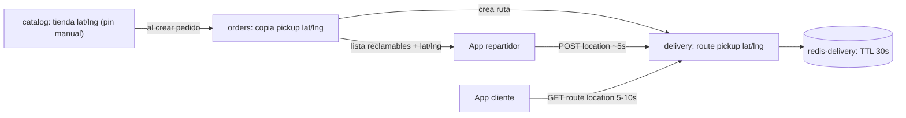

# Ubicación en tiempo real del repartidor

El backend guardará la última posición conocida del repartidor mientras tenga una ruta activa, permitirá que el cliente la consulte durante su pedido y expondrá las coordenadas de retiro para que el repartidor ordene los pedidos reclamables por cercanía. Como prerrequisito, las tiendas tendrán coordenadas cargadas con un pin manual.

**Estado:** diseño aprobado  
**Feature ODD:** `odd/tasks/courier-live-location.md`  
**Servicios:** `catalog-service`, `orders-service`, `delivery-service`, stack de infraestructura

## Decisiones aprobadas

| Tema | Decisión |
| --- | --- |
| Usos | Mapa del cliente durante el pedido y orden por cercanía de los pedidos reclamables. |
| Almacenamiento | Última posición en `redis-delivery` (dedicado) con TTL de 30 s. |
| Transporte | Polling: el repartidor envía cada ~5 s y el cliente consulta cada 5–10 s. |
| Dispatch | Pull. El orden por distancia lo calcula la app del repartidor. |
| Coordenadas de tienda | Pin manual en catalog, copiado al pedido y a la ruta al crearse. |
| Historial | Fuera de alcance. Se habilitará con un Redis Stream volcado a Postgres. |

## Por qué existe el cambio

No hay ningún dato geográfico en el backend: las direcciones de tienda y de ruta son texto libre. Sin coordenadas no se puede mostrar al repartidor en un mapa ni ordenar pedidos por distancia.

## Por qué Redis y no solo Postgres

Con dispatch pull, el cálculo de cercanía es una posición contra una lista corta de pedidos, por lo que no hace falta `GEOSEARCH` ni PostGIS. Redis se elige por:

- Escrituras de alta frecuencia (una cada ~5 s por repartidor) sin generar carga ni bloat en Postgres.
- El TTL descarta posiciones viejas sin jobs de limpieza.
- Un futuro dispatch push podrá usar `GEOSEARCH` sobre repartidores sin migrar el almacenamiento.

Redis no es durable por defecto. Perder la última posición en un reinicio es aceptable porque se repone en segundos. El historial, cuando exista, sí debe persistir en Postgres.

Se usa un contenedor dedicado y no el `redis-cache` del gateway: cada servicio es dueño de sus datos (AGENTS.md §2) y el tráfico de ubicaciones no debe degradar el rate limiter del gateway.

## Flujo de datos



## 1. Coordenadas de la tienda (`catalog-service`)

- Nueva migración: `latitude numeric(9,6)` y `longitude numeric(9,6)`, ambas nullable, en la tabla de tiendas.
- Validación: latitud en [-90, 90] y longitud en [-180, 180]. Se cargan siempre juntas o ninguna.
- La respuesta de tienda que consume `orders-service` expone ambos campos.

## 2. Copia al crear el pedido (`orders-service` → `delivery-service`)

- `orders-service` copia las coordenadas de la tienda en su `DeliveryRoute` (`pickupLatitude`, `pickupLongitude`) junto a `pickupAddress`.
- `CreateDeliveryRouteRequest` suma ambos campos opcionales y `delivery_routes` recibe una migración con las columnas nuevas.
- Es una copia y no una referencia: si la tienda se muda, los pedidos ya creados mantienen su punto de retiro.

## 3. Orden por cercanía (uso pull)

- `AvailableDeliveryOrderResponse` suma `pickupLatitude` y `pickupLongitude`.
- La app del repartidor ordena con su propio GPS. Hacerlo en backend obligaría a `orders-service` a pedir la posición a `delivery-service` en cada listado.
- Los pedidos sin coordenadas se muestran al final, marcados como "sin ubicación". No hay fallback silencioso.

## 4. Ubicación en vivo (`delivery-service`)

### Reportar posición

```http
POST /api/delivery/location
Authorization: Bearer <JWT>
Content-Type: application/json

{
  "latitude": -33.4489,
  "longitude": -70.6693,
  "recordedAt": "2026-11-19T03:10:00Z"
}
```

- Requiere rol `Repartidor` y al menos una ruta activa propia (`ASSIGNED`, `RETIRAR_PEDIDO` o `EN_CAMINO`).
- Rechaza coordenadas fuera de rango y `recordedAt` futuro o más antiguo que la posición guardada.
- Rate limit por ruta en el gateway.

### Consultar posición

```http
GET /api/delivery/routes/{routeId}/location
Authorization: Bearer <JWT>
```

- Solo el cliente dueño del pedido, y solo mientras la ruta está en un estado activo.
- Devuelve `404` si no hay posición vigente (TTL vencido). Nunca devuelve una posición vieja.

### Puerto y adaptador

- Puerto de salida `CourierLocationStore` (`save`, `findByDeliveryPerson`, `delete`).
- Adaptador Redis: clave `courier:{deliveryPersonId}:loc` con TTL de 30 s.
- `EraseDeliveryDataUseCase` llama a `delete` para borrar también la ubicación.

## 5. Infraestructura

- Contenedor `redis-delivery` (`redis:7-alpine`) en `gateway/docker/docker-compose.stack.yml`, en la red `floci_default`.
- `REDIS_URL` propio en la task definition de `delivery-service`.

## 6. Pruebas

- Unitarias: use cases, validaciones y autorización, con un fake de `CourierLocationStore` (sin Docker).
- `*IT.java`: adaptador Redis con Testcontainers y migraciones de catalog, orders y delivery.

## Entrega

El cambio toca tres servicios y la infraestructura, así que se divide en PRs encadenados:

1. `catalog`: coordenadas de tienda.
2. `orders` + `delivery`: copia de coordenadas de retiro y exposición en la lista de reclamables.
3. `delivery` + infraestructura: `redis-delivery` y endpoints de ubicación en vivo.

## Fuera de alcance

- Historial y auditoría del recorrido.
- Dispatch push y modelado de disponibilidad o turno del repartidor.
- SSE o WebSocket.
- Geocoding automático de direcciones.
