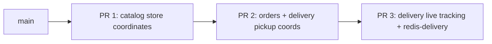

# Implementation plan: courier live location

This plan executes the approved design in `docs/plans/2026-11-19-courier-live-location-design.md`. The canonical feature specification is `odd/tasks/courier-live-location.md`; every contributor must read that file through `## Log` before editing and report the covered `S#` values.

## Delivery strategy (chained PRs)

The change spans three services (`catalog-service`, `orders-service`, `delivery-service`) plus gateway/stack configuration and exceeds the 400-line single-PR review budget. Deliver it as **3 additive, reviewable PRs** where each PR leaves `main` deployable on its own:



| PR | Work units | Specs | Scope | Rollback boundary |
|---|---|---|---|---|
| PR 1 | WU-1 | S5 | `catalog-service` store coordinates (migration, API, tests) | Revert catalog commit; new columns are nullable and unused until PR 2. |
| PR 2 | WU-2, WU-3 | S1, S4, S5 | `delivery-service` route pickup coords + `client_user_id`; `orders-service` propagation + `AvailableDeliveryOrderResponse` | Revert orders then delivery commit; all added fields are nullable/optional. |
| PR 3 | WU-4, WU-5, WU-6 | S1, S2, S3 | `redis-delivery` container, gateway rate limits, `CourierLocationStore`, live report & polling endpoints | Revert delivery endpoints/adapter and stack config; existing route flows are unaffected. |

## Work-unit sequence

| WU | PR | Depends on | Scope | Expected commit |
|---|---|---|---|---|
| WU-1 | PR 1 | none | Store coordinates (`latitude`/`longitude`) in `catalog-service` + manual pin update endpoint. | `feat(catalog): add manual store coordinates` |
| WU-2 | PR 2 | none | Pickup coordinates + `client_user_id` on `internal.delivery_routes` in `delivery-service`. | `feat(delivery): store pickup coordinates and client user id on routes` |
| WU-3 | PR 2 | WU-1, WU-2 | Propagate pickup coordinates and `clientUserId` from `orders-service` and expose coordinates on claimable orders. | `feat(orders): propagate pickup coordinates for claimable orders` |
| WU-4 | PR 3 | none | Add dedicated `redis-delivery` container, delivery `REDIS_URL`, and gateway rate-limit overrides. | `chore(infra): add dedicated redis-delivery container and gateway rate limits` |
| WU-5 | PR 3 | WU-4 | Add `CourierLocationStore` port, Redis adapter (30s TTL), and `EraseDeliveryDataUseCase` hook in `delivery-service`. | `feat(delivery): add redis courier location store and erasure hook` |
| WU-6 | PR 3 | WU-2, WU-5 | Add `POST /api/delivery/location` and `GET /api/delivery/routes/{routeId}/location` in `delivery-service`. | `feat(delivery): add courier location report and customer polling endpoints` |

WU-1 and WU-2 do not share edit surfaces and may be implemented concurrently. WU-3 depends on the additive DTO contracts from WU-1 and WU-2. WU-6 depends on `client_user_id` (WU-2) and `CourierLocationStore` (WU-5).

---

## WU-1: manual store coordinates (`catalog-service`)

### Behavior

- Add Flyway migration `services/catalog-service/src/main/resources/db/migration/V8__add_restaurant_coordinates.sql` adding nullable `latitude numeric(9,6)` and `longitude numeric(9,6)` to `public.restaurant`, with `CHECK` constraints enforcing `latitude BETWEEN -90 AND 90`, `longitude BETWEEN -180 AND 180`, and `(latitude IS NULL) = (longitude IS NULL)`.
- Extend `Restaurant` domain model and `RestaurantEntity` / JPA mapper with `latitude` and `longitude` (`BigDecimal`).
- Add `PUT /api/catalog/my/restaurant/location` in `MyStoreRestaurantController` (role `Restaurante`, owner check via `GetRestaurantByUserIdUseCase` pattern) backed by a new `SetStoreLocationUseCase`. Accepting both coordinates sets them; accepting both `null` clears them; providing only one returns `400`.
- Accept optional `latitude`/`longitude` pair on restaurant creation in `AdminRestaurantController` (same pair/range validation).
- Expose `latitude` and `longitude` in `RestaurantResponse`, `AdminRestaurantResponse`, and `InternalRestaurantResponse`.

### Tests

- Unit tests for `SetStoreLocationUseCase` and coordinate validation (valid pair, out-of-range lat/lng, half-pair rejected, clearing with both nulls, non-owner denied).
- Web/controller test for `MyStoreRestaurantController` (`PUT /api/catalog/my/restaurant/location`).
- Flyway + JPA integration test (`*IT.java`) verifying the `CHECK` constraints and persistence.

### Focused checks

```bash
cd services/catalog-service && ./gradlew test
```

---

## WU-2: route pickup coordinates and `client_user_id` (`delivery-service`)

### Behavior

- Add Flyway migration `services/delivery-service/src/main/resources/db/migration/V9__delivery_routes_pickup_coordinates.sql` (bump version number if `feat/order-commune` merges to `main` first) adding nullable `pickup_latitude numeric(9,6)`, `pickup_longitude numeric(9,6)`, and `client_user_id varchar(64)` to `internal.delivery_routes`, with the same coordinate range and pair `CHECK` constraints as WU-1.
- Extend `DeliveryRoute`, `DeliveryRouteEntity`, JPA mapper, `CreateDeliveryRouteRequest` (optional `pickupLatitude`, `pickupLongitude`, `clientUserId`), and `RouteResponse`.
- Storing `client_user_id` on the route lets `GET /api/delivery/routes/{routeId}/location` (WU-6) authorize the owning customer locally on every 5–10s poll without an internal HTTP call to `orders-service`.
- Update `EraseDeliveryDataUseCase` so erasing a customer's `userId` also clears `client_user_id` on their routes if applicable.

### Tests

- Unit tests for `CreateDeliveryRouteRequest` validation (valid pair, invalid range, half-pair rejected, null pair allowed).
- JPA / migration integration test verifying new columns and constraints.

### Focused checks

```bash
cd services/delivery-service && ./gradlew test
```

---

## WU-3: coordinate propagation and claimable list (`orders-service`)

### Behavior

- Extend `InternalRestaurantDto` and `RestaurantInfo` in `orders-service` to deserialize `latitude` and `longitude` from `catalog-service`.
- Extend `orders-service`'s domain `DeliveryRoute` with `pickupLatitude` and `pickupLongitude`, populated from `RestaurantInfo` in `CreateOrderUseCase` alongside `pickupAddress` (snapshot at order creation, not a live reference).
- Update `DeliveryHttpClientAdapter` to include `pickupLatitude`, `pickupLongitude`, and `clientUserId` when calling `POST /api/internal/routes`.
- Extend `AvailableDeliveryOrderResponse` and `OrderController#toAvailableDeliveryResponse` with nullable `pickupLatitude` and `pickupLongitude` so the courier app can sort claimable orders by distance client-side. Orders without coordinates return `null` explicitly (no silent fallback).
- No Flyway migration is needed in `orders-service`: `orders` does not own `delivery_routes` and resolves restaurant data via `CatalogHttpClientAdapter`.

### Tests

- Unit tests for `CreateOrderUseCase` and `DeliveryHttpClientAdapter` verifying coordinate and `clientUserId` forwarding (both present and absent).
- Controller test for `AvailableDeliveryOrderResponse` serialization with coordinates present and null.

### Focused checks

```bash
cd services/orders-service && ./mvnw test
```

---

## WU-4: dedicated `redis-delivery` and gateway rate limits (`infra` + `gateway`)

### Behavior

- Add a dedicated `redis-delivery` service (`redis:7-alpine`, separate volume `redis-delivery-data`, healthcheck `redis-cli ping`, on `floci_default`) in `gateway/docker/docker-compose.stack.yml`. Do **not** share `redis-cache` with the gateway.
- Add `REDIS_URL=redis://redis-delivery:6379` to `infra/floci/task-definitions/delivery-service.dev.json` and wire `spring.data.redis.url` (with env override) in `services/delivery-service/src/main/resources/application-delivery.yml`, plus `delivery.location.ttl-seconds` (default `30`).
- Add route-level rate-limit overrides in `gateway/config/gateway.yaml` (and `gateway.example.yaml`) for `POST /api/delivery/location` (e.g. burst-tolerant ~1 req/3s per courier) and `GET /api/delivery/routes/:id/location` (polling ~1 req/4s).

### Tests

- Gateway config schema / unit tests (`pnpm test:unit` in `gateway/`) confirming the YAML remains valid under Zod validation.
- Docker compose config validation (`docker compose -f gateway/docker/docker-compose.stack.yml config -q`).

### Focused checks

```bash
cd gateway && pnpm test:unit
```

---

## WU-5: `CourierLocationStore` port and Redis adapter (`delivery-service`)

### Behavior

- Add `org.springframework.boot:spring-boot-starter-data-redis` to `services/delivery-service/build.gradle.kts`.
- Add domain value object `CourierLocation(BigDecimal latitude, BigDecimal longitude, Instant recordedAt)` enforcing lat/lng bounds and non-null `recordedAt`.
- Add outbound port `CourierLocationStore`:
  - `void save(Long deliveryPersonId, CourierLocation location)`
  - `Optional<CourierLocation> findByDeliveryPersonId(Long deliveryPersonId)`
  - `void deleteByDeliveryPersonId(Long deliveryPersonId)`
- Implement `RedisCourierLocationStoreAdapter` using key `courier:{deliveryPersonId}:loc` (JSON or hash payload with `lat`, `lng`, `recordedAt`) with TTL from `delivery.location.ttl-seconds` (default 30s).
- Wire `CourierLocationStore#deleteByDeliveryPersonId` into `EraseDeliveryDataUseCase` so account deletion purges any active Redis location entry.
- Guard the Redis adapter with `@ConditionalOnProperty` / profile configuration consistent with existing delivery adapters so unit tests never require Redis.

### Tests

- Unit tests for `CourierLocation` validation and `EraseDeliveryDataUseCase` verifying `deleteByDeliveryPersonId` is invoked.
- Integration test `RedisCourierLocationStoreAdapterIT` using Testcontainers (`GenericContainer("redis:7-alpine")`) verifying save, read, overwrite, delete, and TTL expiration.

### Focused checks

```bash
cd services/delivery-service && ./gradlew test
```

---

## WU-6: live location endpoints (`delivery-service`)

### Behavior

- Add `ReportCourierLocationUseCase` and `POST /api/delivery/location`:
  - Requires JWT role `Repartidor`.
  - Resolves `DeliveryPerson` from JWT `sub` and verifies the courier has at least one active route (`ASSIGNED`, `RETIRAR_PEDIDO`, `EN_CAMINO`); otherwise returns `409` or `403` (document exact status in controller advice).
  - Validates `latitude` (`[-90, 90]`), `longitude` (`[-180, 180]`), and `recordedAt` (rejects timestamps more than 5s in the future to allow minor clock skew, and ignores/rejects timestamps older than the currently stored `recordedAt`).
  - Saves to `CourierLocationStore` and returns `204 No Content`.
- Add `GetRouteLocationUseCase` and `GET /api/delivery/routes/{routeId}/location`:
  - Requires JWT role `Cliente`.
  - Loads route by `routeId`; verifies `route.clientUserId` matches JWT `sub` (`403` otherwise) and route status is active (`ASSIGNED`, `RETIRAR_PEDIDO`, `EN_CAMINO`; returns `404` when route is pending, terminal, or has no `deliveryPersonId`).
  - Reads `CourierLocationStore#findByDeliveryPersonId(route.deliveryPersonId)`. Returns `404` when absent or TTL expired; never returns stale data.
  - Returns `200 OK` with `{ "routeId", "latitude", "longitude", "recordedAt" }` inside the standard `ApiResponse` envelope.

### Tests

- Unit tests for `ReportCourierLocationUseCase` using an in-memory fake `CourierLocationStore`: active route happy path, no active route rejected, out-of-range coords rejected, future `recordedAt` rejected, older `recordedAt` rejected.
- Unit tests for `GetRouteLocationUseCase`: owning client + active route + fresh location returns 200; wrong client returns 403; terminal/unassigned route returns 404; missing/expired Redis key returns 404.
- Controller tests (`@WebMvcTest` or existing `DeliveryControllerTest` pattern) verifying JWT role enforcement and response envelopes.

### Focused checks

```bash
cd services/delivery-service && ./gradlew test
```
